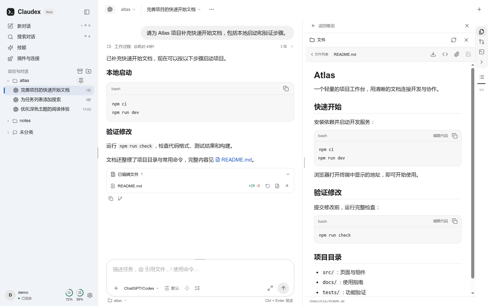
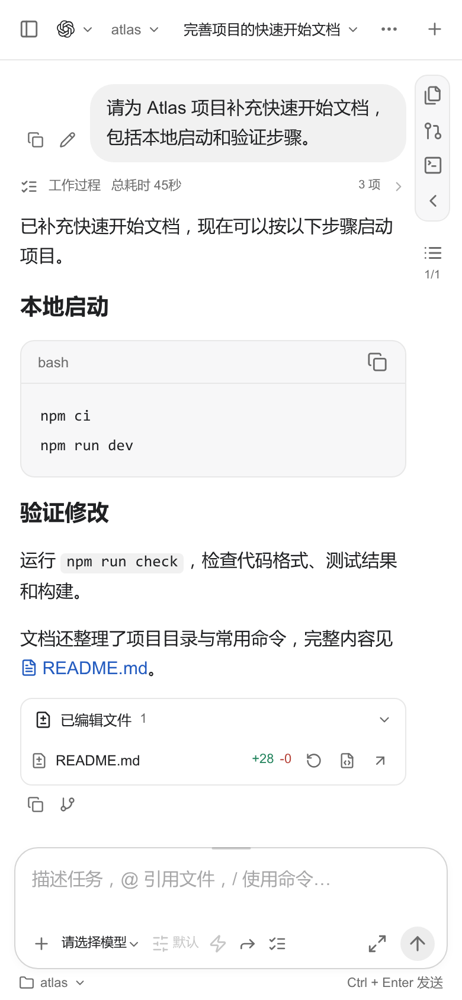
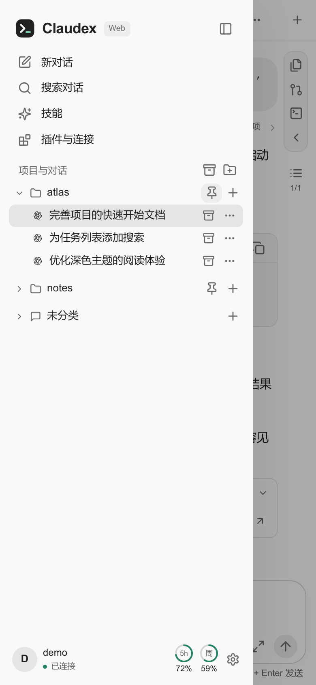

<p align="center">
  
</p>

<h1 align="center">Claudex Web</h1>

<p align="center">
  <strong>在浏览器中，继续你的 Codex 与 Claude Code 工作。</strong><br>
  在电脑上部署，通过电脑、手机或平板访问同一工作环境。
</p>

<p align="center">
  <a href="#快速开始">快速开始</a> ·
  <a href="#命令行用法">命令行用法</a> ·
  <a href="docs/deployment.md">部署指南</a> ·
  <a href="https://github.com/hjd-hitsz/claudex-web/releases">版本更新</a>
</p>

<picture>
  <source media="(prefers-color-scheme: dark)" srcset="docs/images/desktop-dark.png">
  
</picture>

<p align="center"><sub>桌面界面 · 演示数据</sub></p>

<details>
<summary>查看手机界面</summary>

<p align="center">
  
  
</p>

</details>

## 快速开始

需要 Linux、Node.js 24.5+ 和 npm。Debian / Ubuntu 安装系统依赖可执行以下命令。

```bash
sudo apt-get install openssl pamtester
```

以运行服务的普通用户安装，安装 npm 上的最新稳定版本。

```bash
npm install -g @hjd-hitsz/claudex-web
```

使用 systemd 托管时，执行 `claudex-web service install`，需要开机自启动时再执行 `loginctl enable-linger "$USER"`。也可以用 `claudex-web start` 直接启动网页进程，使用 Codex 时在另一个终端运行 `claudex-web backend`。运行方式见[部署指南](docs/deployment.md#命令与前台运行)。

浏览器打开 `https://部署电脑的IP:8766`，输入运行服务的系统用户名和密码。从其他设备访问或使用 P2P 时，还需输入验证器里的六位动态码。首次使用动态码时，按[命令行用法](#命令行用法)绑定验证器。首次访问的证书配置见[证书安装指引](docs/deployment.md#证书配置)。

跨网络使用时，可在“设置 → 连接与登录”开启默认关闭的 P2P 远程访问。打开连接链接，等直连建立后按同样的步骤登录。网页与命令行用法见 [P2P 远程访问](docs/deployment.md#p2p-远程访问)。

## 配置 Codex

在网页「设置 → 后端」中为 Codex 点击「一键安装」。

### 使用 ChatGPT 账户

```bash
codex login
```

### 使用自定义模型服务

编辑 `~/.codex/config.toml`。合并以下配置，把模型 ID 和地址替换为服务提供的值。`model` 和 `model_provider` 放在文件顶部、所有表头之前。

```toml
model = "your-model-id"
model_provider = "custom"

[model_providers.custom]
name = "Custom"
base_url = "https://model.example/v1"
wire_api = "responses"
requires_openai_auth = true
```

## 配置 Claude Code

在网页「设置 → 后端」中为 Claude Code 点击「一键安装」，然后启用该后端。

### 使用 Claude 账户

以运行服务的同一系统用户登录，然后在网页模型菜单中选择 Claude 原生模型。

```bash
claude auth login
```

### 使用自定义供应商和模型

在网页「设置 → 模型服务商」中点击「添加供应商」。

DeepSeek 等预置供应商直接填写 API Key。

## 命令行用法

- 用 `claudex-web --help` 查看命令。

* **双重验证**用 `claudex-web auth setup [名称]` 为认证应用生成绑定二维码。每人登录时输入自己验证器中的六位动态码。查看、撤销和关闭方法见[双重验证](docs/deployment.md#双重验证)。
* **P2P** 用 `claudex-web p2p enable` 开启远程访问，再用 `claudex-web p2p create "我的手机"` 生成链接。其他操作见 [P2P 远程访问](docs/deployment.md#p2p-远程访问)。
* **systemd 部署**用 `claudex-web service status` 查看状态，用 `claudex-web service restart-when-idle` 等待空闲后重启。
* 其他命令见[部署指南](docs/deployment.md#命令与前台运行)。

## 更多文档

- [部署与维护](docs/deployment.md)包含端口、证书、网络代理、服务管理、升级和故障排查。
- [开发者指南](docs/development.md)介绍源码运行与开发验证，[架构设计](docs/architecture.md)说明模块边界。
- [版本更新](https://github.com/hjd-hitsz/claudex-web/releases)与[变更日志](CHANGELOG.md)记录版本变化。

## 致谢

感谢 [ysys143/xsm](https://github.com/ysys143/xsm) 为通用对话管理器的设计提供参考。

## 许可证

Copyright (C) 2026 Claudex Web contributors.

Claudex Web 采用 [GNU General Public License v3.0](LICENSE)（SPDX：`GPL-3.0-only`）发布。你可以按 GNU GPL 第 3 版的条款使用、复制、修改和分发本项目。担保与责任限制见许可证正文，第三方依赖沿用各自的许可证。
