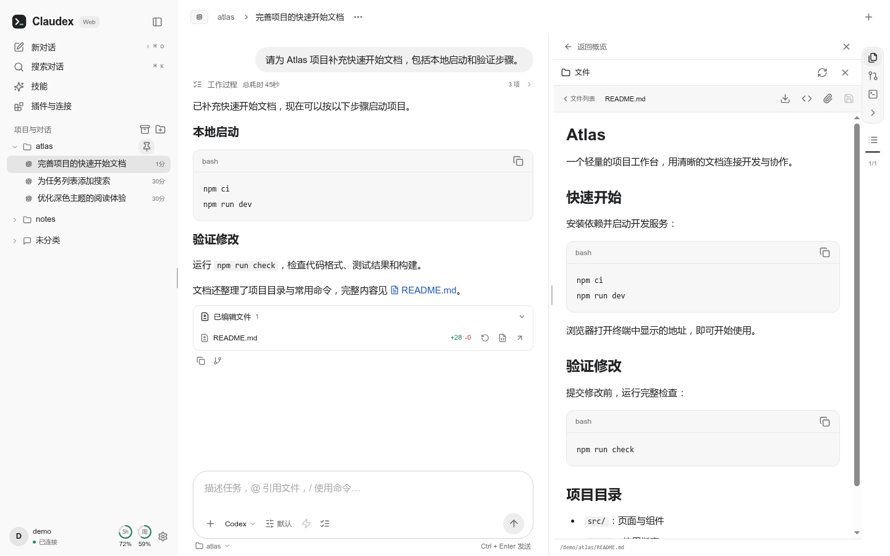
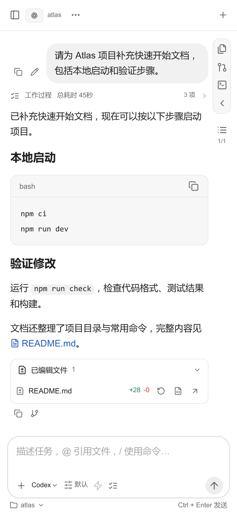

<p align="center">
  
</p>

<h1 align="center">Claudex Web</h1>

<p align="center">
  <strong>在浏览器中，继续你的 Codex 与 Claude Code 工作。</strong><br>
  在电脑上部署，通过电脑、手机或平板访问同一工作环境。
</p>

<p align="center">
  <a href="#快速开始">快速开始</a> ·
  <a href="docs/deployment.md">部署指南</a> ·
  <a href="https://github.com/hjd-hitsz/claudex-web/releases">版本更新</a>
</p>

<picture>
  <source media="(prefers-color-scheme: dark)" srcset="docs/images/desktop-dark.png">
  
</picture>

<p align="center"><sub>桌面界面 · 演示数据</sub></p>

<details>
<summary>查看手机界面</summary>

<p align="center">
  
  
</p>

</details>

## 快速开始

需要 Linux、Node.js 24+、npm 和 systemd。Debian / Ubuntu 安装系统依赖可执行以下命令。

```bash
sudo apt-get install openssl pamtester
```

以运行服务的普通用户安装，安装 npm 上的最新稳定版本。

```bash
npm install -g @hjd-hitsz/claudex-web
claudex-web service install
```

浏览器打开 `https://部署电脑的IP:8766`，使用该电脑上运行服务的系统用户名和密码登录。首次访问的证书配置见[证书安装指引](docs/deployment.md#证书配置)。

需要开机启动并在退出系统登录后继续运行时，执行 `loginctl enable-linger "$USER"`。

## 配置 Codex

在网页“设置 → 模型与服务配置”中为 Codex 点击“一键安装”。

### 使用 ChatGPT 账户

```bash
codex login
```

### 使用自定义模型服务

编辑 `~/.codex/config.toml`。合并以下配置，把模型 ID 和地址替换为服务提供的值。`model` 和 `model_provider` 放在文件顶部、所有表头之前。

```toml
model = "your-model-id"
model_provider = "custom"

[model_providers.custom]
name = "Custom"
base_url = "https://model.example/v1"
wire_api = "responses"
requires_openai_auth = true
```

## 配置 Claude Code

在网页“设置 → 模型与服务配置”中为 Claude Code 点击“一键安装”，然后启用该后端。

### 使用 Claude 账户

以运行服务的同一系统用户登录，然后在网页模型菜单中选择 Claude 原生模型。

```bash
claude auth login
```

### 使用自定义供应商和模型

在网页“设置 → Claude Code”的供应商列表中添加服务。

DeepSeek 等预置供应商直接填写 API Key。

## 更多文档

- [部署与维护](docs/deployment.md)包含端口、证书、网络代理、服务管理、升级和故障排查。
- [开发者指南](docs/development.md)介绍源码运行与开发验证，[架构设计](docs/architecture.md)说明模块边界。
- [版本更新](https://github.com/hjd-hitsz/claudex-web/releases)与[变更日志](CHANGELOG.md)记录版本变化。

## 许可证

Copyright (C) 2026 Claudex Web contributors.

Claudex Web 采用 [GNU General Public License v3.0](LICENSE)（SPDX：`GPL-3.0-only`）发布。你可以按 GNU GPL 第 3 版的条款使用、复制、修改和分发本项目。担保与责任限制见许可证正文，第三方依赖沿用各自的许可证。
