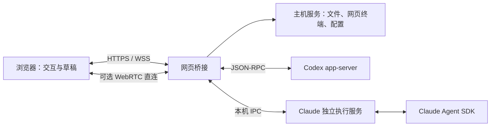

# Claudex Web 架构总览

本文件是每次任务开始时必读的架构入口，概括系统组成、依赖方向和状态归属。阅读后，AI Agent 根据任务自主选择下方专题及章节，并沿实际调用链查验实现。

## 系统组成

Claudex Web 是连接一个 Codex app-server 和一个 Claude Code 运行时的浏览器工作台。React 前端提供统一交互，Node.js 网页桥接负责身份验证、请求路由与主机工作区；两个原生后端各自执行模型任务并保存历史。

网页关闭或桥接重启时，原生模型任务继续由所属运行时持有。Claude 执行服务独立于桥接进程；Codex 后台终端扩展的任务服务负责后台结果投递。本地翻译在独立子进程中执行 CPU 推理。

## 模块与依赖

- `client/src/app` 组装应用外壳与路由，`features` 组织业务界面并通过参数取得外壳操作，`ui` 提供基础控件。`main.jsx` 只挂载，`store.js` 连接 React 订阅与应用动作。
- 前端核心依赖方向为 `application → infrastructure → domain → shared`，应用层也可直接使用领域规则。`application` 管理用例与请求生命周期，`infrastructure` 访问 RPC 和浏览器存储，`domain` 维护纯规则。核心三层保持与 React 无关；`ui` 只依赖本层与领域层。
- `server/src/server.mjs` 与 `application.mjs` 组装服务。`http` 处理 HTTP，`bridge` 维护公共网页操作，`backends/manager.mjs` 路由固定的两个后端，`workspace` 提供主机文件和网页交互终端。
- HTTP 与公共桥接通过参数取得所需服务和状态；`backends/codex` 与 `backends/claude` 分别管理自己的原生传输、订阅与执行。公共桥接保持与具体后端解耦，两个原生适配器保持独立。
- `shared` 提供跨端纯逻辑，只依赖本层；前后端通过协议协作。`packages/background-terminal` 与 `packages/translation-engine` 各自只依赖本子项目及外部包。

源码依赖图保持无环。新增职责沿上述边界放置；跨组件状态变更由应用控制器协调，状态和服务通过显式参数注入。

## 状态与生命周期

原生后端保存对话、轮次和工具历史，是恢复执行结果的事实来源。桥接只持有网页连接及网页专用状态，原生会话和后台任务由所属适配器及运行时管理。网页交互终端的进程与缓冲区归主机工作区服务。

网页配置、证书、登录状态、项目偏好及 Claude 网页索引保存在 `CLAUDEX_WEB_CONFIG_DIR`；原生配置沿用 `CODEX_HOME` 与 `CLAUDE_CONFIG_DIR`。浏览器持有草稿、界面偏好和文件编辑缓冲区。私有持久文件采用权限限制与原子写入；目录设置和迁移见[部署与维护](deployment.md#数据保存与迁移)。

前端共享状态保存跨组件事实。频繁更新路径上的独立视图使用选择订阅，读取原始值或引用稳定的数据。草稿使用独立订阅，避免每次输入刷新完整历史。展开状态、选区、滚动位置和编辑器实例归组件，未保存文件按所属主对话保留。发送读取输入快照，成功后只清理已提交内容。

请求链为“界面 → 应用用例 → RPC → 桥接 → 所属后端”，通知与历史读取共同更新界面。请求确认、轮次结束和进程退出分别结算。异步结果按资源标识、请求修订和连接代次隔离，实时事件优先于迟到读取；断线保留草稿和可读历史，恢复后核对原生状态。每个异步操作明确取消、清理、失败呈现和恢复依据。

局域网浏览器使用同源 HTTPS/WSS。可选 P2P 使用链接授权和 HTTPS 信令建立 WebRTC 直连，随后使用与局域网一致的网页登录流程。业务请求校验所属传输的登录会话，退出或过期撤销会话和传输权限。协议和生命周期见[传输与维护契约](architecture/behavior.md#传输与维护契约)。

## 构建与验证

根 npm workspaces 使用单一锁文件。生产桥接读取 `client/dist`，根包 `files` 白名单控制发行内容。`style.css` 按顺序导入职责样式；Vite 交付根部 JavaScript 分块和单一 CSS，按需加载保持原有样式顺序与编辑缓冲区生命周期。新增运行模块或分块同时验证生产路由和安装包。

`npm run architecture:check` 检查源码行数、导入存在性、循环和分层方向；`npm run check` 依次检查版本、架构、格式、单元与组件、构建及发行包安装。测试命令和适用场景由开发指南维护，模块或状态边界变化同步更新相应约束与回归。

## 专题导航

以下按职责提供下一层入口，Agent 自主判断本任务需要哪些内容。

- **产品行为**：[功能与状态契约](architecture/behavior.md)。
  - [对话与历史](architecture/behavior.md#对话项目与历史)、[输入与草稿](architecture/behavior.md#输入草稿与执行)、[计划](architecture/behavior.md#计划模式)及[目标](architecture/behavior.md#目标交互)。
  - [工作区、文件与终端](architecture/behavior.md#工作区文件与终端)、[子代理与渲染](architecture/behavior.md#子代理与共享渲染)、[账户与界面](architecture/behavior.md#账户登录与外观)。
- **原生后端**：[双后端产品契约与实施](architecture/backends.md)，包含适配器职责、执行生命周期与协议差异；[回归审查](architecture/backend-regressions.md)保留兼容基线与验证依据。
  - [命令覆盖](cli-command-coverage.md)维护快捷命令及原生扩展；[Codex 后台终端](background-tasks.md)维护独立任务扩展；[翻译引擎](../packages/translation-engine/README.md)维护独立翻译子项目。
- **开发与交付**：[开发者指南](development.md)提供本地环境、测试入口和源码服务操作。
  - [部署与维护](deployment.md)维护安装、配置、迁移和排障；[版本管理](versioning.md)维护版本准备、发布及重试。
