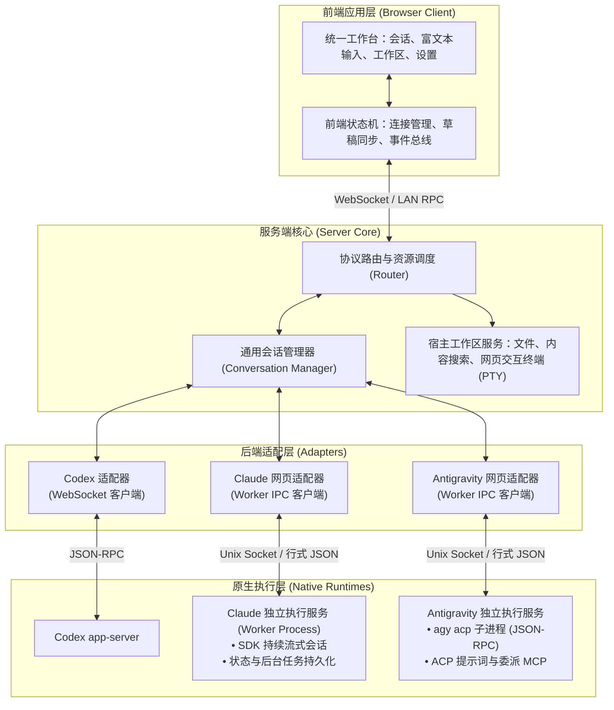

# 多后端架构契约与实施规范

本文档定义 Claudex Web 连接与调度多个底层 AI 运行时（Codex、Claude Code、Antigravity）的核心系统架构、接口契约及状态流转标准。后端适配层负责吸收原生协议差异，向前端统一工作台提供一致的产品操作语义。

---

## 1. 系统架构与分层设计

Claudex Web 采用“统一应用工作台 + 通用会话管理 + 插件化后端适配器”的分层架构：



### 1.1 核心职责划分

- **服务端核心路由与标识映射**：负责管理全局连接与资源标识转换。默认 Codex 保留原生 ID，其他后端统一投影为 `backend:<后端ID>:<原生ID>`，屏蔽各原生 ID 的命名冲突与协议差异。
- **宿主工作区服务 (`server/src/workspace/service.mjs`)**：统一提供本地文件操作、基于 `rg --fixed-strings` 的代码片段内容精准匹配（`codeLine`）、文件名模糊搜索（`fuzzyFileSearch`），以及由 `node-pty` 持有的网页交互终端。
- **通用会话管理器 (`server/src/conversation-manager/`)**：作为所有会话活跃状态与跨会话协作事实的全局单一事实源（Single Source of Truth），统一汇聚轮次生成状态与后台终端状态。
- **后端适配层 (`server/src/backends/`)**：实现标准化的适配器接口，吸收不同运行时的进程生命周期、认证环境与原生协议。

---

## 2. 后端适配器通用契约 (Backend Adapter Contract)

所有后端适配器均在 `server/src/backends/manager.mjs` 中通过工厂组装，满足统一的服务端契约方法：

```typescript
interface BackendAdapter {
  connect(): Promise<void> | void;
  ready: boolean;
  capabilities: BackendCapabilities;
  receive(client: ClientContext, message: RpcMessage): Promise<void>;
  state(): BackendStateSnapshot;
  releaseClient(client: ClientContext): void;
  releaseUnusedThreads(): Promise<void> | void;
  close(): Promise<void> | void;
  workspaceOwner: "backend" | "bridge";
}
```

### 2.1 核心契约方法与生命周期行为

1. **握手与就绪判定 (`connect`, `ready`, `capabilities`)**：
   - `shared/product-contract.mjs` 冻结了导出的工作区方法、会话方法与 Antigravity 委派方法清单；
   - **Codex**：`connect` 建立原生 WebSocket 连接，在成功完成原生 `initialize` 握手并收到 `initialized` 响应后置 `ready: true`；
   - **Claude Code 与 Antigravity**：适配器先连接底层的独立 Worker IPC 服务，取得当前 Worker 的就绪快照后置 `ready: true`；
   - `capabilities` 声明真实可用的模型列表、上下文窗口大小及思考强度档位。

2. **请求代理与资源标识转换 (`receive`)**：
   - 接收经过路由分发的产品 RPC 请求；适配器负责在浏览器全局标识与底层原生标识之间进行解包与包装；
   - 客户端提问回答、审批确认及工具请求均通过统一通道双向中继。

3. **工作区所有权与命令路由 (`workspaceOwner`)**：
   - **Codex (`workspaceOwner: "backend"`)**：工作区文件操作与原生命令交由底层 app-server 执行；当跨主机连接时直接操作远端工作区；
   - **Claude Code 与 Antigravity (`workspaceOwner: "bridge"`)**：工作区文件操作与命令由服务端宿主工作区服务统一承接；
   - **网页交互终端**：所有后端的 `lan/terminal/*` 均独立于 `workspaceOwner`，由宿主 `node-pty` 统一管理。

4. **客户端连接释放与会话回收 (`releaseClient`, `releaseUnusedThreads`, `close`)**：
   - **Codex 链路**：
     - `releaseClient`：移除指定浏览器连接的会话订阅权，并触发空闲释放检查；
     - 空闲释放机制：已落盘持久化的空闲会话即使仍在网页中打开，也能释放桥接连接占用的原生订阅；若存在进行中轮次、上下文整理、活动目标、后台终端交接或在途请求，则自动推迟释放；
     - 启动参数配置 `-c thread_unload_delay_secs=0`，使无订阅的空闲会话能够被底层及时卸载；
   - **Claude Code 链路**：
     - `releaseClient` 为空操作（会话由独立常驻 Worker 管理，浏览器关闭不中断模型任务）；
     - `releaseUnusedThreads`：向 Worker 发送 IPC `release` 指令；Worker 内部每 30 秒扫描一次，当会话空闲满 5 分钟且无运行轮次、无未决提问、无活动目标且无 `running` / `pending` 后台任务时，关闭该会话对应的 SDK 查询进程；
   - **Antigravity 链路**：
     - 会话由 ACP 会话内部独立的空闲计时器进行生命周期回收。

---

## 3. 通用会话管理器 (Conversation Manager)

通用会话管理器独立于各原生适配器，集中处理会话活跃度归并、多后端目录分页与跨会话消息调度。

### 3.1 会话活动状态机与多源归并 (`activity.mjs`)

为根除多端状态割裂，管理器抽象出统一的状态投影函数 `projectConversationActivity(thread)`：

```javascript
const status =
  background && ["idle", "unknown"].includes(observed)
    ? "background"
    : observed;

return {
  ...thread,
  status,
  background,
  generating,
  live: status !== "idle" && status !== "unknown",
};
```

#### 状态投影与流转规则：

1. **状态分类**：
   - `generating`：底层运行时正在执行模型生成或流式输出；
   - `background`：当前无活跃轮次（原生处于 `idle` 或 `unknown`），但存在关联的后台活跃终端/任务；
   - `live`：只要 `status` 既非 `idle` 也非 `unknown`，即判定为 `live: true`；
2. **卸载（Unloaded）会话事实找回机制（Codex 链路）**：
   - Codex 适配器读取原生已加载会话列表（调用 `thread/backgroundTerminals/list`）；
   - 后台任务服务通过任务持久化日志（`job-<UUID>.json`）的反查机制：根据文件变更发现记录并提取 `threadId`，向后台服务核实是否存在状态为 `running` 的实际任务；
   - 确认有运行任务后，即使该会话在原生 app-server 中已被卸载（状态为 `notLoaded`），适配器仍通过 `thread/read { includeTurns: false }` 读取元数据，将其投影为 `status: "background"` 且 `live: true`；
3. **网页活动快照发布 (`lan/conversations/activity`)**：
   - 前端定时（页面可见且每轮读取结束后隔 3 秒）调用此接口获取 `{ activities, complete }`；
   - 快照将底层各后端的活动事实与桥接当前跟踪的 `activeTurns` 进行合并，补齐 `turnId`，供侧栏与顶部切换器驱动展示。

### 3.2 跨会话协作与通信账本 (`store.mjs` & `manager.mjs`)

管理器通过内置的 SQLite 账本（`<configDir>/conversation-manager/messages.sqlite`）提供安全的会话间通信（`thread_chat`）：

- **数据结构与去重**：`messages` 表以 `(sender_runtime, sender, request)` 为唯一键，防止重复派发；
- **状态流转与退避重试**：
  - 投递调度经历 `accepted` $\rightarrow$ `dispatching` $\rightarrow$ `delivered` / `failed`；
  - 若提交中断或服务重启，残留的 `dispatching` 重置为 `unknown` 并进入回执核对；
  - 投递退避间隔从 5 秒按倍数增长至 60 秒，并由会话生命周期事件即时唤醒；
- **原生投递适配**：
  - Codex：以携带结构化 `toolOutput` 的原生轮次提交并核对历史记录；
  - Claude Code：以唯一消息 UUID 核对 Worker 队列及 SDK 消息历史，支持在生成中同轮动态注入。

---

## 4. 后端专有运行时与协议实现

### 4.1 Claude 独立 Worker 架构与热替换

- **受限 IPC 通信**：
  - 网页桥接与 Worker 通过受限 Unix Domain Socket 通信，路径基于 `stateDir` 的绝对路径哈希与用户身份确定，权限严格限制为目录 `0700`、socket `0600`；
  - 数据传输采用单行上限 128 MiB 的逐行 JSON-RPC 协议；
- **进程管理与部署模式**：
  - 支持 systemd 用户服务单元或脱离终端的守护进程启动；
- **代码修订哈希与热替换 (Worker Revision)**：
  - 桥接计算 `server/src`、`shared` 下所有 `.mjs`、`.json` 及 `package.json` 的 SHA-256 综合哈希；
  - 当检测到代码版本或执行配置变化且当前 Worker 完全空闲时，发送 `shutdown` 请求并重启新代次 Worker；
  - 若 Worker 存在在途请求或活动轮次，原子拒绝替换（返回 `EWORKERBUSY`），确保用户任务不中断。

### 4.2 Antigravity 秘书后端与委派全链路

- **双层架构通道**：
  - 网页桥接经由 Unix IPC 连接独立的 agy Worker；Worker 内部作为 ACP Client 通过子进程标准输入输出与 `agy acp`（Agent Control Protocol）交换逐行 JSON-RPC；
- **提示词与模式注入**：
  - 会话创建与续接时，通过 ACP 的 `_meta.antigravity.systemPrompt.append` 字段注入秘书角色定义；
  - 角色正文选取优先级：当前预设 $\rightarrow$ 用户保存的 `secretary.md` $\rightarrow$ 仓库内置默认 `prompt/secretary/secretary.md`；
- **权限与审批自动处理**：
  - ACP 原生的 `session/request_permission` 权限请求优先选择 `allow_once`，次选 `allow_always`；
  - 执行端的提问与审批通过独立事件流中继至主会话，由用户确认后回传；
- **委派派单与证据调阅 (`claudex_delegation`)**：
  - 秘书端通过 MCP 工具 `ask_codex` / `ask_claude` 发起异步委派，任务与回执持久化存入 `delegation/state.json`；
  - 底层完成后，Worker 在主会话空闲时调用 `session/prompt` 将阶段结论与产物回投；
  - 秘书端使用 `read_delegation_step` 按 8 位短 ID 查询原生 Rollout 或工具日志，单次超长详情支持分段流式拼接。

---

## 5. 架构质量与验收契约

所有多后端特性的维护与演进必须遵循以下技术准则：

1. **单一事实源与防穿透**：所有关于会话是否活跃（live）、处于何种运行阶段的计算，必须严格收拢在通用会话管理器内，严禁前端或业务路由私自拼凑逻辑；
2. **后台任务与会话生命周期绑定**：无论是 Codex 任务日志反查还是 Claude Worker 任务列表，只要进程存在，会话即处于 `live: true`，并在结束轮次后准确呈现 `background`；
3. **确定性证据链**：所有异步委派与跨会话协作，均需落盘记录唯一请求标识、发送/接收端点与原生回执，具备断线恢复与幂等重试能力。
