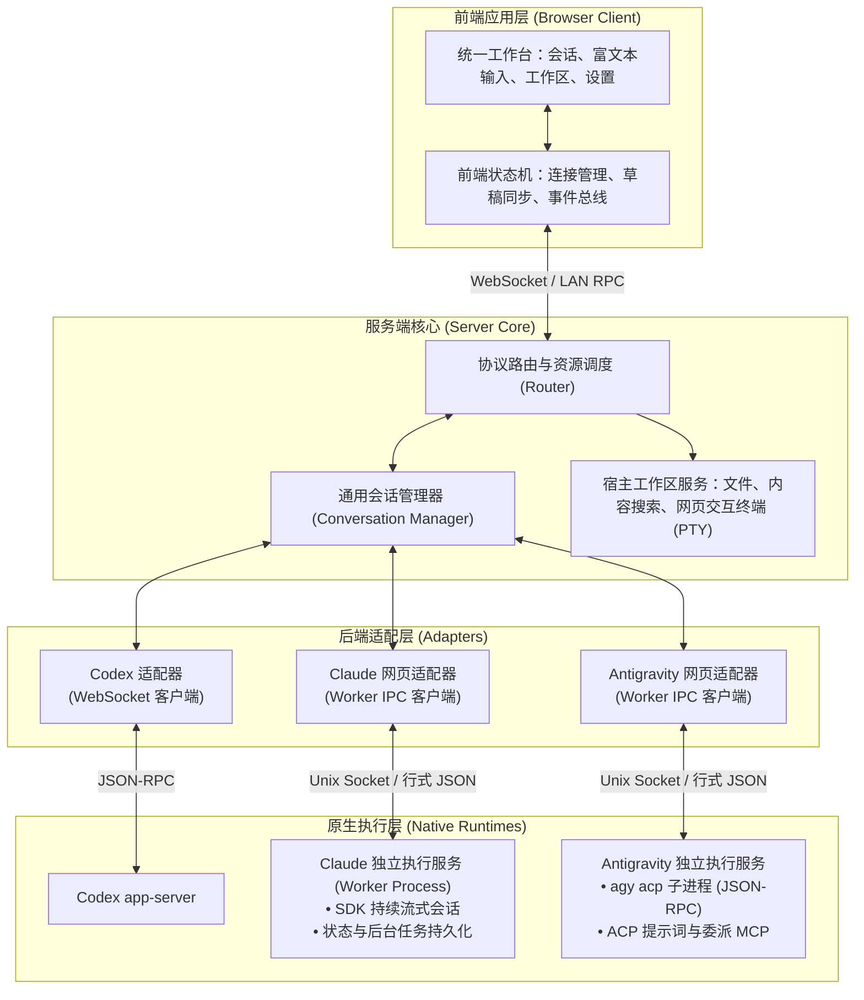

# 多后端架构契约与实施规范

本文档定义 Claudex Web 连接与调度多个底层 AI 运行时（Codex、Claude Code、Antigravity）的核心系统架构、接口契约及状态流转标准。后端适配层负责吸收原生协议差异，向前端统一工作台提供一致的产品操作语义。

---

## 1. 系统架构与分层设计

Claudex Web 采用“统一应用工作台 + 通用会话管理 + 插件化后端适配器”的分层架构：



### 1.1 核心职责划分

- **服务端核心路由与标识映射**：负责管理全局连接与资源标识转换。默认 Codex 保留原生 ID，其他后端统一投影为 `backend:<后端ID>:<原生ID>`，屏蔽各原生 ID 的命名冲突与协议差异。
- **宿主工作区服务 (`server/src/workspace/service.mjs`)**：统一提供本地文件操作、基于 `rg --fixed-strings` 的代码片段内容精准匹配（`codeLine`）、文件名模糊搜索（`fuzzyFileSearch`），以及由 `node-pty` 持有的网页交互终端。
- **通用会话管理器 (`server/src/conversation-manager/`)**：作为所有会话活跃状态与跨会话协作事实的全局单一事实源（Single Source of Truth），统一汇聚轮次生成状态与后台终端状态。
- **后端适配层 (`server/src/backends/`)**：实现标准化的适配器接口，吸收不同运行时的进程生命周期、认证环境与原生协议。

---

## 2. 后端适配器通用契约 (Backend Adapter Contract)

所有后端适配器均在 `server/src/backends/manager.mjs` 中通过工厂组装，满足统一的服务端契约方法：

```typescript
interface BackendAdapter {
  connect(): Promise<void> | void;
  ready: boolean;
  capabilities: BackendCapabilities;
  receive(client: ClientContext, message: RpcMessage): Promise<void>;
  state(): BackendStateSnapshot;
  releaseClient(client: ClientContext): void;
  releaseUnusedThreads(): Promise<void> | void;
  close(): Promise<void> | void;
  workspaceOwner: "backend" | "bridge";
}
```

### 2.1 核心契约方法与生命周期行为

1. **握手与就绪判定 (`connect`, `ready`, `capabilities`)**：
   - `shared/product-contract.mjs` 冻结了导出的工作区方法、会话方法与 Antigravity 委派方法清单；
   - **Codex**：`connect` 建立原生 WebSocket 连接，在成功完成原生 `initialize` 握手并收到 `initialized` 响应后置 `ready: true`；
   - **Claude Code 与 Antigravity**：适配器先连接底层的独立 Worker IPC 服务，取得当前 Worker 的就绪快照后置 `ready: true`；
   - `capabilities` 声明真实可用的模型列表、上下文窗口大小及思考强度档位。

2. **请求代理与资源标识转换 (`receive`)**：
   - 接收经过路由分发的产品 RPC 请求；适配器负责在浏览器全局标识与底层原生标识之间进行解包与包装；
   - 客户端提问回答、审批确认及工具请求均通过统一通道双向中继。

3. **工作区所有权与命令路由 (`workspaceOwner`)**：
   - **Codex (`workspaceOwner: "backend"`)**：工作区文件操作与原生命令交由底层 app-server 执行；当跨主机连接时直接操作远端工作区；
   - **Claude Code 与 Antigravity (`workspaceOwner: "bridge"`)**：工作区文件操作与命令由服务端宿主工作区服务统一承接；
   - **网页交互终端**：所有后端的 `lan/terminal/*` 均独立于 `workspaceOwner`，由宿主 `node-pty` 统一管理。

4. **客户端连接释放与会话回收 (`releaseClient`, `releaseUnusedThreads`, `close`)**：
   - **Codex 链路**：
     - `releaseClient`：移除指定浏览器连接的会话订阅权，并触发空闲释放检查；
     - 空闲释放机制：已落盘持久化的空闲会话即使仍在网页中打开，也能释放桥接连接占用的原生订阅；若存在进行中轮次、上下文整理、活动目标、后台终端交接或在途请求，则自动推迟释放；
     - 启动参数配置 `-c thread_unload_delay_secs=0`，使无订阅的空闲会话能够被底层及时卸载；
   - **Claude Code 链路**：
     - `releaseClient` 为空操作（会话由独立常驻 Worker 管理，浏览器关闭不中断模型任务）；
     - `releaseUnusedThreads`：向 Worker 发送 IPC `release` 指令；Worker 内部每 30 秒扫描一次，当会话空闲满 5 分钟且无运行轮次、无未决提问、无活动目标且无 `running` / `pending` 后台任务时，关闭该会话对应的 SDK 查询进程；
   - **Antigravity 链路**：
     - 会话由 ACP 会话内部独立的空闲计时器进行生命周期回收。

---

## 3. 通用会话管理器 (Conversation Manager)

通用会话管理器独立于各原生适配器，集中处理会话活跃度归并、多后端目录分页与跨会话消息调度。

### 3.1 会话活动状态机与多源归并 (`activity.mjs`)

`projectConversationActivity` 将各事实所有者提供的当前状态按会话合并。每项事实都独立进入 `activities`，数组有值时 `live` 为 `true`。单值 `status` 使用以下顺序中首项活动，活动清空后返回 `idle` 或保留来源的 `unknown`。

| `activities` 优先顺序                   | 事实与退出条件                                                       |
| --------------------------------------- | -------------------------------------------------------------------- |
| `waitingForApproval`、`waitingForInput` | 原生或桥接交互请求仍待答复                                           |
| `compacting`、`reverting`               | 上下文整理或文件撤销的运行生命周期                                   |
| `running`、`queued`                     | 原生交互轮次或等待处理的运行时输入                                   |
| `goal`                                  | 原生目标处于自动执行的 `active` 状态                                 |
| `background`                            | 原生后台终端、Claude 后台命令或后台任务服务确认进程运行中            |
| `delegating`                            | 主会话存在已接收、启动中、运行中、等待输入的委派，或委派结果正在回投 |
| `subAgents`                             | 运行中的 Codex 子会话或 Claude 本地代理任务                          |
| `collaborating`、`waitingForPeer`       | 合作消息仍在投递或核对，或发起方明确登记的回复等待尚未结束           |

生成、后台和委派事实分别以 `generating`、`background` 和 `delegating` 字段公开。审批、输入与整理期间可以保留进行中轮次，同时暂停 `generating` 指示。桥接保留 `turnId` 供网页跟踪实际轮次结束。

原会话与委派主会话采用同一请求分类。模型提问和普通 MCP elicitation 进入 `waitingForInput`，命令、文件、额外权限和明确标记为工具审批的请求进入 `waitingForApproval`。Codex 桥接声明 `openai/standard-form-input`，由原生运行时决定是否上报表单或 URL 请求。`approvalPolicy: "never"` 允许向符合条件的用户根会话下发表单，URL 请求仍受原生审批策略控制。

Codex 通过 `thread/loaded/list`、`thread/backgroundTerminals/list` 和 `thread/read` 组合原生会话及子会话元数据，通过 `thread/goal/get` 和 `thread/queue/list` 查询已加载、已发现或收到原生状态事件的会话。后台任务服务按落盘任务记录反查所属 `threadId`，向实际任务服务核实进程状态，再读取已卸载会话的元数据。委派投影按原生运行时和主会话 ID 索引持久化 `tasks` 与 `notices`，执行结果回投进入 `queued` 或 `submitting` 时继续保持活跃，直到回投结算。

Claude Worker 提供运行中轮次、权限和输入等待、持久化输入队列、目标、整理、文件撤销和后台任务状态。Antigravity Worker 提供 ACP 轮次、显式启动新轮次时的待提交输入、问题与整理事实，管理器从秘书状态文件读取持久化委派。网页交互终端按工作目录和终端进程 ID 寻址，独立于以会话 ID 挂载的后台工作。

网页通过 `lan/conversations/activity` 获取跨已启用后端的 `{ activities, complete }` 快照。`list_active_threads` 使用同一投影查询调用者所在运行时的会话，返回 `status`，并为同时具有多种活动的会话返回 `activities`。

### 3.2 跨会话协作与通信账本 (`store.mjs` & `manager.mjs`)

管理器通过内置的 SQLite 账本（`<configDir>/conversation-manager/messages.sqlite`）提供安全的会话间通信（`thread_chat`）：

- **数据结构与去重**：`messages` 表以 `(sender_runtime, sender, request)` 为唯一键，防止重复派发；
- **回复等待**：发起方调用 `thread_chat` 的 `send` 时可传 `expectReply: true`。管理器在账本中持久化等待状态，收到成功投递的关联回复、原消息投递失败或发起方调用 `stop_waiting` 时结束等待。`reply` 使用原消息 ID 关联；
- **状态流转与退避重试**：
  - 投递调度经历 `accepted` $\rightarrow$ `dispatching` $\rightarrow$ `delivered` / `failed`；
  - 若提交中断或服务重启，残留的 `dispatching` 重置为 `unknown` 并进入回执核对；
  - 投递退避间隔从 5 秒按倍数增长至 60 秒，并由会话生命周期事件即时唤醒；
- **原生投递适配**：
  - Codex：以携带结构化 `toolOutput` 的原生轮次提交并核对历史记录；
  - Claude Code：以唯一消息 UUID 核对 Worker 队列及 SDK 消息历史，支持在生成中同轮动态注入。

---

## 4. 后端专有运行时与协议实现

### 4.1 Claude 独立 Worker 架构与热替换

- **受限 IPC 通信**：
  - 网页桥接与 Worker 通过受限 Unix Domain Socket 通信，路径基于 `stateDir` 的绝对路径哈希与用户身份确定，权限严格限制为目录 `0700`、socket `0600`；
  - 数据传输采用单行上限 128 MiB 的逐行 JSON-RPC 协议；
- **进程管理与部署模式**：
  - 支持 systemd 用户服务单元或脱离终端的守护进程启动；
- **代码修订哈希与热替换 (Worker Revision)**：
  - 桥接计算 `server/src`、`shared` 下所有 `.mjs`、`.json` 及 `package.json` 的 SHA-256 综合哈希；
  - 当检测到代码版本或执行配置变化且当前 Worker 完全空闲时，发送 `shutdown` 请求并重启新代次 Worker；
  - 若 Worker 存在在途请求或活动轮次，原子拒绝替换（返回 `EWORKERBUSY`），确保用户任务不中断。
- **对话历史与代理归属**：
  - 网页通过 SDK 导入原生记录，在内存中沿整理边界的逻辑父节点恢复压缩前后的主会话。SDK 继续选择消息链并关联工具结果。手动整理的完成标记归入 `/compact` 轮次，自动整理的标记归入触发整理的执行轮次。独立保存的网页轮次按开始时间并入历史。
  - 子代理入口由原生启动事件建立，工具调用 ID 和启动轮次随代理保存。完成事件更新同一入口，后续轮次开工后仍归原轮次。旧整理轮次中的完成记录依原生子代理或已保存的启动与工具关联核对。

### 4.2 Antigravity 秘书后端与委派全链路

ACP 能力缺口、桥接侧替代方案与原生切换条件见[Antigravity 能力缺失](../future_plan.md#antigravity-能力缺失)。

- **双层架构通道**：
  - 网页桥接经由 Unix IPC 连接独立的 agy Worker；Worker 内部作为 ACP Client 通过子进程标准输入输出与 `agy acp`（Agent Control Protocol）交换逐行 JSON-RPC；
- **工作过程与回答**
  - Worker 将相邻的 `agent_thought_chunk` 合并为一条思考记录。新的工具调用或文件变更结束当前分组，同一工具与文件变更的状态更新沿用原位置。网页按落盘顺序展示思考和操作，长标题可展开查看完整摘要。
  - `agent_message_chunk` 保留 Markdown 文本及围栏，实时消息和历史回答通过共用消息组件呈现，其中 Mermaid 围栏使用共用图表组件。
- **提示词与模式注入**：
  - 会话创建与续接时，通过 ACP 的 `_meta.antigravity.systemPrompt.append` 字段注入秘书角色定义；
  - 角色正文选取优先级：当前预设 $\rightarrow$ 用户保存的 `secretary.md` $\rightarrow$ 仓库内置默认 `prompt/secretary/secretary.md`；
- **生成中补充说明**：
  - agy 1.5.18 通过同一 ACP 会话上的第二次 `session/prompt` 接收补充输入，已发出的模型请求继续运行，补充指令进入后续模型请求。带工具的轮次在工具结果进入上下文后的下一次模型调用中应用补充。纯文本回复继续生成至当前请求结束，随后处理补充。
  - Worker 校验网页轮次标识，保存补充输入，沿用同一网页轮次和 ACP 更新流。agy 1.5.18 可在收到补充时提前返回旧请求的 `end_turn`。最新一条请求在文本流结束后返回，Worker 等在途请求全部返回，以最新一条的结果结算轮次。轮次变化时，输入框保留被拒绝的补充草稿。主动停止使用 `session/cancel`，整理期间暂停接收补充。
  - 已启动的模型循环沿用该轮的模型和思考强度。发送补充说明时保存的模型设置供下一轮独立执行使用。
- **上下文整理**：
  - agy 1.5.18 的秘书代理将 `/compact` 视作普通消息。网页手动整理时使用隔离摘要代理生成检查点，创建新的秘书会话，再一次性保存原生会话映射和待注入的摘要。网页对话标识及已展示的轮次继续使用原记录。续接请求先携带摘要，再提交用户消息或委派回投。
  - 摘要代理在独立临时工作区运行，`PreToolUse` 钩子拒绝原生工具执行。进行中的委派或尚待投递、核对的当前结果占用原生会话，手动整理在回投结算后受理。
  - agy 1.5.18 的 ACP 未发送检查点事件。适配器只读比较原生会话数据库中已完成的检查点序号，确认原生自动整理并呈现完成记录。
  - `usage_update.used` 和 `size` 分别提供当前上下文占用与模型窗口上限。手动整理启用新会话后，上下文占用等待新会话的用量通知。目录响应未提供自动整理阈值。
  - `session/prompt` 结束响应的 `usage` 提供该轮输入、缓存读取、输出、推理输出及总量。Worker 随轮次保存已上报的字段，最近一轮的快照随会话返回。agy 1.5.18 使用 Gemini 时，ACP 的输入扣除缓存读取，输出包含推理。自动整理前后的模型调用可计入同一轮总量，手动整理记录隔离摘要请求的用量。
- **按轮次分叉与编辑重发**：
  - “从这里继续”通过 `thread/fork` 保存截至选定轮次的历史和新的秘书原生会话。原位编辑通过 `thread/revert` 一次保存截断前缀及新的原生映射，随后沿用 `turn/start` 发送编辑后的消息。网页对话在编辑时沿用原标识，两种操作均保留来源的原生会话。
  - 新会话准备阶段加载模型、思考强度、秘书角色和委派 MCP。首次提交将保留的用户与助手消息、已结束的工具与结果摘要作为文本记录，随新消息一并提交。agy 1.5.18 的通用工具结果可按 ACP 调用 ID 从原生记录只读补齐。复制网页历史、准备原生会话及刷新回读期间均不发起对话轮次。
  - Worker 在轮次、队列、整理或委派执行及结果回投占用时拒绝改写历史。编辑重发同时核对历史末尾，防止接管期间收到的新输入被覆盖。会话映射切换前撤销旧 ACP 连接和 MCP 令牌，事件只进入该连接当前已提交的轮次。
- **历史元数据**：
  - agy 1.5.18 缺少 ACP 改名、归档、恢复和删除方法。Worker 按当前网页对话的原生 ID 修改标题 annotation。原生运行时从 annotation 读取标题并更新摘要索引，会话数据库中的轮次正文继续保留。
  - CLI 和 ACP 的活动历史仍列出带 `archived` annotation 的会话。网页归档将原生会话数据库移到同一存储卷的私有目录 `.claudex-history/archived/`，新读取的原生列表随之隐藏该会话。网页恢复将数据库移回原路径。旧网页归档仍可恢复。分叉、编辑或整理前独立保留的原生历史沿用其自身生命周期。
  - Worker 检查进行中的轮次、排队输入、维护操作、委派与回投。删除还查询委派执行端的后台终端，后台状态无法核对时拒绝删除。关闭本 Worker 的 ACP 会话后取得原生 presence 锁，校验会话数据库身份与 SQLite 排他锁。删除将当前会话文件及侧车隔离暂存，用事务删除摘要索引中该会话的记录，并清理全局摘要和 CLI 列表缓存中的对应条目。
  - 文件操作使用同卷重命名和私有恢复日志。网页状态保存成功后清理暂存，失败时回滚。Worker 重启按已保存的操作标识核对未完成日志。
- **权限与审批自动处理**：
  - ACP 原生的 `session/request_permission` 权限请求优先选择 `allow_once`，次选 `allow_always`；
  - 执行端的提问与审批通过独立事件流中继至主会话，由用户确认后回传；
- **委派派单与证据调阅 (`claudex_delegation`)**：
  - 秘书端通过 MCP 工具 `ask_codex` / `ask_claude` 发起异步委派，任务与回执持久化存入 `delegation/state.json`；
  - Codex 的 `research` 执行会话在创建和恢复时使用 `sandbox: "read-only"`，每次执行和后台完成续跑使用 `sandboxPolicy: { type: "readOnly", networkAccess: false }`。各入口使用 `approvalPolicy: "never"`。执行端可读取、搜索和运行只读命令，沙箱返回实际写入或联网错误。改动文件使用新建的 `implementation` 任务，其执行会话使用完全访问和无审批。
  - 网页桥接以 Antigravity 和原生委派账本中的任务范围、Codex 运行时标识及执行线程 ID 确认归属。研究线程可在网页读取历史并按 ID 只读恢复，直接提交轮次、修改权限、分叉及以该线程执行命令由桥接拒绝。普通 Codex 对话和无所属会话的独立命令沿用既有权限。
  - 委派的 `subAgentActivity` 投影在 `delegation.taskSummary` 携带首个步骤的可选任务标题，`prompt` 携带该步骤的派单正文。实时事件、Antigravity 历史和 Codex／Claude Code 的 `lan/delegation/tasks` 共用该投影。列表条目以委派任务为单位，续问沿用首个步骤的标题。
  - 执行端到达终态后，按已归属的原生轮次固化回投正文。派单轮答复在前，后台终端完成、软检查和其他原生续跑依次追加。每轮优先使用最终答复原文，其次使用本轮已有文字，空轮跳过。多段回投和完整过程正文共用续跑分段格式。单触发的标题包含任务名和 ID。多触发的标题显示完成、软检查或混合批次的项数，正文前按触发顺序列出每项任务名、任务 ID 和已有的运行 ID，混合批次逐项标注完成或软检查。单段回投保留答复原文。Codex 后台轮由原生触发与任务 ID 核对，Claude Code 使用原生任务通知及运行 ID。独立用户轮截断本步骤的收录，旧步骤的后台批次按既有归属排除。
  - Worker 在主会话空闲时调用 `session/prompt`，回投任务和步骤标识、状态、固化的正文、上下文用量和实际执行错误。Codex 和 Claude Code 发起的委派使用同一结果载荷。无正文时发送状态和已有错误，用户主动停止对应 `stopped_by_user`。回执沿用实际提交的载荷，已投递记录保留原投递状态，旧账本沿用原步骤答复和结论。
  - 步骤的阶段、完整过程正文、末轮结论和调用链保存在委派状态中。网页卡片从回投的首个可用答复生成预览，点击后读取执行端原生会话。秘书端用 `read_delegation_step` 按任务和步骤列出调用，以 `filter` 对命令、参数和路径做忽略大小写的子串检索，以 `callId` 查看原生输入和输出。列表按调用分页，超长详情按 JSON 字符串分段，两者通过 `nextOffset` 继续读取。
- **后台终端与插件目录**：
  - Worker 按秘书会话、委派执行会话和 Codex 运行时身份，从 Claudex 后台任务服务读取 MCP 后台终端。输出读取保留执行端的完成投递状态。单项停止和 `/stop` 调用任务服务取消对应进程。Codex 原生终端、Claude 原生 Bash 和 agy 原生 `/tasks` 分别由所属运行时管理。
  - Codex 研究线程在新建或卸载后恢复时关闭 Claudex 后台终端 MCP。旧线程若仍由原生客户端订阅，Codex 会沿用已加载的工具目录，任务服务继续按委派账本拒绝宿主命令启动。原生 `exec_command` 的长进程沿用启动时的只读权限，由任务服务订阅完成事件并投递续跑结果。
  - 「插件与连接」通过 agy CLI 的只读列表显示已安装插件和 MCP 启停配置。秘书会话的 `claudex_delegation` 使用当前 ACP 连接的 MCP 工具清单与就绪回执显示连接状态。两项本地目录独立读取，读取失败时保留另一项及已确认的会话连接。
- **技能、命令与附件**：
  - Worker 从秘书代理的 `available_commands_update` 取得原生命令。目录读取与发送校验共用选择规则，优先使用当前 ACP 会话最近发布的完整目录，尚无会话通知时复用后台读取的秘书目录。`skills/list` 直接读取这两处目录，原生会话由续接或提交打开。网页优先处理共用命令，在秘书会话中隐藏 `/plan`、`/goal` 和 `/review`。选中的原生命令通过 `session/prompt` 交由 agy 展开，补入恢复上下文时仍位于提示开头。
  - agy 1.5.18 的秘书代理隔离工作区规则和钩子，目录也因此省去项目技能。Worker 列出工作目录至仓库根的项目技能，用户显式选中后读取当前 `SKILL.md` 并将正文作为 ACP 内嵌资源提交。支持 `.agents` 及同级目录别名的直接技能子目录。
  - Worker 根据 `promptCapabilities.embeddedContext` 将上传文件转换为 ACP `resource`，URI 保留文件名，文本资源携带原文。1.5.18 跳过 `resource.blob`，二进制附件通过文本资源携带原媒体类型和 Base64 字节。此编码占用模型上下文，格式解析取决于模型。图片沿用 ACP `image`，代码行引用沿用带位置的文本。

---

## 5. 架构质量与验收契约

所有多后端特性的维护与演进必须遵循以下技术准则：

1. **单一事实源与防穿透**：所有关于会话是否活跃（live）、处于何种运行阶段的计算，必须严格收拢在通用会话管理器内，严禁前端或业务路由私自拼凑逻辑；
2. **后台任务与会话生命周期绑定**：无论是 Codex 任务日志反查还是 Claude Worker 任务列表，只要进程存在，会话即处于 `live: true`，并在结束轮次后准确呈现 `background`；
3. **确定性证据链**：所有异步委派与跨会话协作，均需落盘记录唯一请求标识、发送/接收端点与原生回执，具备断线恢复与幂等重试能力。
