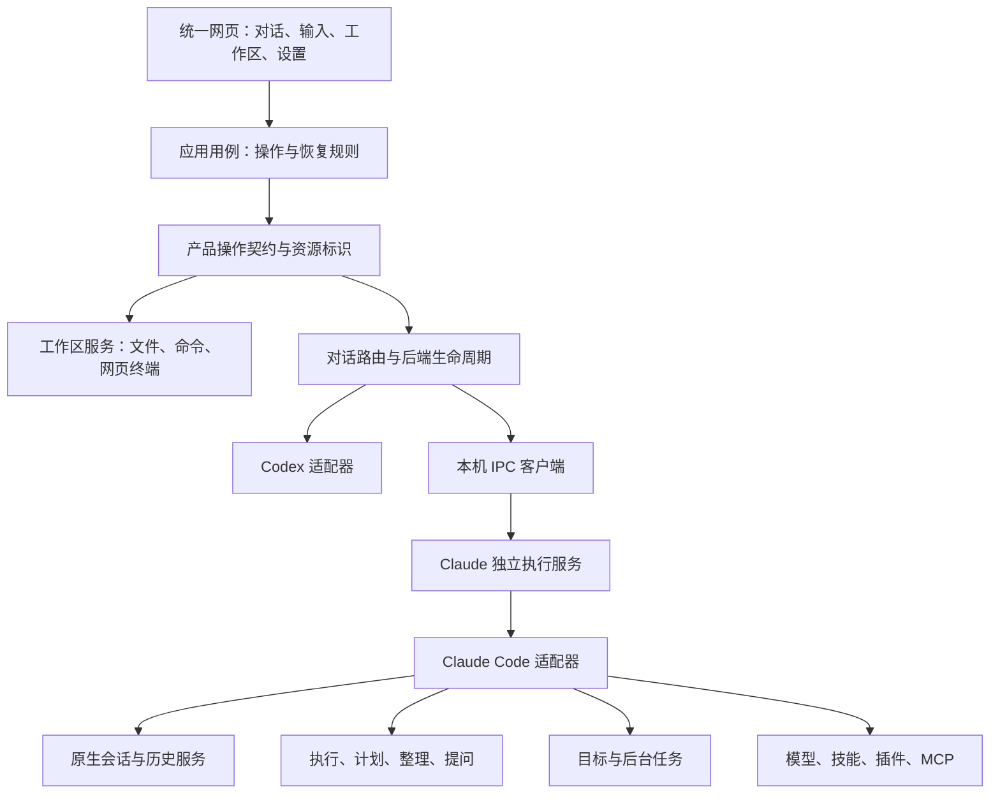

# 双后端产品契约与实施

Claudex Web 提供一致的浏览器工作台，连接一个 Codex app-server 和一个 Claude Code 运行时。模型选择决定执行后端，用户操作及其状态、错误恢复和数据保护规则由网页产品契约决定。后端适配层负责实现完整契约；原生协议差异在服务端吸收。既有 Codex 的正常调用链作为回归基线，Claude 适配补齐同一产品操作，共享实现按实际职责确定。

## 职责与依赖

工作区目录浏览、文件保存和网页交互终端属于桥接主机。Codex 的工作区请求沿用原生 app-server；Claude 的查询和文件读取优先使用原生控制接口，超出原生读取大小范围的完整文件由已有认证 HTTP 服务传输。模型生成的文件变更、对话历史、计划与后台任务按所属对话保存；后台任务的管理与网页交互终端分别维护。

浏览器继续采用现有消息协议名称以兼容既有状态控制器。方法名是传输表示，产品契约中的功能分组、输入输出及生命周期才是适配器实现依据。`shared/product-contract.mjs` 将工作区方法与对话方法分别注册为 `workspaceMethods` 和 `conversationMethods`，供桥接按状态所有者路由。完整产品范围按下文的用户操作与状态契约维护，新增网页功能同步维护所属路由及实际操作验收。

### 适配器边界

管理器通过相同接口使用两个后端，Codex 原生实现位于 `backends/codex/`，Claude 原生实现位于 `backends/claude/`。接口的操作与生命周期约定如下：

- `connect()` 启动所属传输，`ready` 表达当前就绪状态，`capabilities` 提供真实模型参数与扩展能力。
- `receive(client, message)` 接收原生资源标识的请求或提问回答，通过注入的 `send` 返回同一请求编号的结果或错误，通过 `broadcast` 发布统一事件。管理器承担浏览器资源标识与原生标识的转换，用户正文和工具参数保持原样。
- `state()` 返回 `lan/state` 快照，其中活动轮次、提问、整理、原生命令及撤销结果均使用原生标识。网页手动终端独立使用工作区标识，由管理器合并工作区快照。Claude 执行服务补充后台任务、排队输入及内部命令占用。管理器汇总快照并加入网页配置与版本信息。
- `releaseClient(client)` 释放该适配器中属于指定浏览器代理的连接资源。Codex 清除订阅所有者并检查空闲释放，Claude 的模型会话独立于浏览器连接，释放浏览器保持执行服务运行。管理器只调用接口，订阅集合由 Codex 自己持有。
- `releaseUnusedThreads()` 按所属运行时的生命周期释放空闲资源；`close()` 关闭桥接连接并结算其在途请求。独立执行服务通过 `shutdown()` 原子检查实际占用并确认停止，网页桥接的 `close()` 只断开 IPC。
- `workspaceOwner` 明确工作区路由所有者：`backend` 保留原生工作区调用，`bridge` 使用管理器持有的主机工作区服务。Codex 选择前者，Claude 选择后者。管理器按声明路由，两端原生文件搜索与文件读取继续进入所属适配器。

`bridge/product-methods.mjs` 为两个适配器提供同一套网页操作处理器：项目模型读取与保存、目录创建、单文件撤销，以及注入的整理核对和子代理消息读取。模型偏好保存成功广播 `lan/projectModels/updated`，失败保留原文件并允许重试。Codex 继续读取网页配置目录中的偏好，并在目标文件缺失时继承旧目录；Claude 继续使用已有后端状态目录。管理器独立提供桌面端未分类目录索引，切换或停用后端保持相同来源。

公共写入规则只读取执行方提供的即时状态。整理占用期间暂停开始轮次、补充输入、审查、回退和再次整理；活动任务或待提交输入阻止新整理；单文件撤销占用期间暂停可能写入的相关操作。原生订阅恢复、会话变更锁和队列原子检查继续归所属适配器。两端共用产品规则，同时保留原生状态的唯一所有者。

## 完整功能范围

以下清单同时约束两个后端。共用界面只实现一次；运行时相关功能分别提供适配及契约回归。

- 对话与项目：创建、重命名、归档、恢复、删除、固定、搜索、实际活动时间排序、未分类目录、完整分页历史、最近页优先、分支与原地编辑重发。
- 输入：Markdown、GFM、公式、中文输入、快捷建议、全部现有命令、Ctrl+Enter、图片附件、文件和目录引用、回复批注、技能、即时发送、草稿及附件隔离。
- 执行：流式消息、思考与翻译、工作过程、命令及工具结果、运行中补充、中断、断线恢复、关闭网页后继续执行、完成通知及多页面去重。
- 计划：只读调查、方案流式正文、预览收放、修改、批准后执行、批准失败重试、刷新恢复及对话切换隔离。
- 整理：异步提交、常驻状态、写入门控、成功和失败、历史核对、刷新与多页面恢复。
- 工作区：文件和目录浏览、模糊查询、源码编辑及未保存缓冲区、差异、媒体和下载、变更汇总、单文件撤销、代码审查、网页交互终端。
- 目标：读取、设置、修改、暂停、恢复、清除、预算、实际用量、持续执行与完成状态。
- 后台任务：读取全部分页、呈现实际运行任务、停止全部后台终端、独立于当前轮次中断。
- 子代理：名称、任务、进度、初始任务和后续消息、完整历史、计划预览、切换隔离和失败重试。
- 配置与连接：账户或供应商身份、模型、思考强度、速度、项目默认选择、插件目录、MCP 状态与工具、后端独立故障、认证、证书、主题、字体、快捷键与版本。

账户余额和套餐等外部事实使用所属服务真实提供的数据，配置自定义供应商时保留供应商身份。使用量、读取失败与缺少外部数据分别表达，任何外部字段缺失均不能影响对话和工作区操作。

Claude Code 原生账户依据 SDK `initializationResult().account` 的实际认证来源确定。未登录时 `account/read` 返回空账户及 `usageSupported: false`，模型选择省去 CLI 在未登录状态仍返回的默认原生模型；配置供应商继续按其配置提供模型和身份。OAuth 认证、API Key 及外部原生提供方分别保留真实身份与适用的用量入口。

自定义模型的上下文容量由供应商模型参数中的 `contextWindow` 记录服务实际加载的 tokens 上限，并通过原生 `CLAUDE_CODE_MAX_CONTEXT_TOKENS` 配置保持 CLI 计量及整理策略一致。模型最大支持容量与当前服务加载容量分别核对；产品默认值保持为空。流式消息开始时即通过 `getContextUsage({detail: "summary"})` 读取原生容量，轮次结束再校准已用上下文；更换原生进程或模型时重新查询，查询失败保留实际用量及错误信息。

Claude Code 的附加能力通过后端扩展描述提供，采用显式命令、工具记录、任务和提问界面呈现。扩展描述保留参数及生命周期，前端无需根据后端名称硬编码功能路径。原生技能、插件、MCP 和子代理目录按当前工作目录与本机 CLI 原有配置读取。Codex 沿用 `CODEX_HOME`，Claude 沿用 `CLAUDE_CONFIG_DIR`，未设置时分别使用 `~/.codex` 和 `~/.claude`。网页自身配置与 Claude 执行状态存入 `CLAUDEX_WEB_CONFIG_DIR`，原生 `dataDir` 与网页 `stateDir` 分别传递。原生模式保留本机认证环境；用户显式选择供应商时，在首次输入前通过原生 `applyFlagSettings` 覆盖该会话的供应商环境，避免原有用户设置改变已选择的请求目标，原配置文件保持原样。

## 验收规则

能力声明用于描述真实的模型参数、外部账户数据和附加能力。完整功能范围中的通用入口始终可用，适配器承担能力转换。新增实现必须通过实际行为验证后才算完成，空结果和硬编码支持标记不能作为实现证据。

两端的验收场景覆盖创建、输入、执行、恢复、编辑、分支、计划、整理、审查、目标及任务，按具体操作记录证据。临时目录和模拟传输验证状态所有者及失败恢复；真实 CLI/SDK 配合隔离 Messages 服务验证原生会话、控制接口和工具；真实模型验证实际供应商调用与模型操作；浏览器验证界面、布局及完整用户流程。每项结果注明实际使用的 CLI、模型与传输来源。

每个异步结果携带所属资源和修订依据。切换模型、供应商、主对话、子代理及断线后，旧结果只归属原目标。历史与索引的修改保持原子性，编辑重发保留原生历史分叉并将网页对话重新指向保留后的会话。

## 已实现的模块与事实来源

- `workspace/service.mjs` 提供共用文件、目录与网页交互终端。网页手动终端统一使用 `lan/terminal/*`，在后端路由之前由工作区服务处理；node-pty 持有实际 shell 和前台进程名称，终端按绝对启动目录隔离，同目录跨模型后端保留，代理的原生命令与后台任务保持原有路径。管理器依据所属后端路由 `fuzzyFileSearch`：Codex 沿用原生 app-server，Claude Code 调用 SDK 的原生 `file_suggestions` 控制请求，复用 CLI 文件索引；查询初始化预热索引并按目录、供应商配置与对话隔离，两者使用相同输入建议和结果展示。
- `claude/sessions.mjs` 管理网页逻辑对话与原生会话的对应关系。`history-actions.mjs` 使用 SDK 原生分支保留消息前缀，依据原生 `forkedFrom.messageUuid` 重新建立轮次、补充输入和自动唤醒消息锚点，截断使用下一轮输入的 `parentUuid` 保留已完成轮次的全部输出附件；网页对话标识保持稳定。`nativeAliases` 将保留的历史分支归入同一逻辑对话，列表和删除后的恢复避免重复导入。
- `session-worker.mjs` 在独立工作进程中使用同一原生配置目录调用 SDK 会话 API；SDK 选择原生 `parentUuid` 链，`native-records.mjs` 通过 SDK `importSessionToStore` 加载临时内存快照，按 UUID 补回投影省略的时间、系统子类型及错误字段。原生正文和工具结果是事实来源，索引补充已确认的轮次状态、计划类型、错误分类和文件变更。
- `worker-client.mjs` 与独立 `worker-server.mjs` 通过受限本机 IPC 协作，执行服务持有 Claude 适配器、原生进程和后台任务。systemd 环境使用独立用户 service 及 cgroup，网页桥接关闭或崩溃后仍保留任务。IPC 目录 0700、socket 0600，双方核对用户归属。源码、入口路径或运行配置变化时，忙碌服务先继续执行，完全空闲后确认停止并替换，较旧桥接保持较新执行代际。
- `runtime.mjs` 管理每个逻辑对话的活动轮次、待提交输入和原生进程；`execution-session.mjs` 持有可持续接收输入的 SDK 会话。普通轮次结束后继续保留原生会话和后台任务，运行中补充进入当前轮次。持续会话空闲满 5 分钟且没有活动轮次、待启动任务、活动目标或原生后台任务时释放，后续发送从原生历史恢复。编辑、分支及删除先结束空闲的原生会话，变更锁与发送入口共用；浏览器和网页桥接连接释放保持模型任务独立运行。正常网页重连恢复同一执行服务的活动快照，独立执行服务故障才进入原生进程核对及未确认输入恢复。
- `messages.mjs` 将原生用户图片及工具返回的图片统一转换为网页媒体内容，保留 base64 数据和 MIME 类型，实时展示与原生历史恢复采用同一转换。
- 模型支持能力与用户思考启停分别处理。`providerModelEnvironment` 将明确配置的自适应支持和 effort 档位映射到原生 `CLAUDE_CODE_MODEL_CAPABILITIES` 部分覆盖规则；自适应支持为 false 时由 CLI 选择固定预算思考及其原生预算，自适应支持为 true 时由 CLI 选择 adaptive。未配置字段保持原生判断。旧的 `ANTHROPIC_DEFAULT_*_MODEL_SUPPORTED_CAPABILITIES` 在 firstParty 请求路径被 CLI 忽略，因此采用实际生效的能力覆盖入口。运行时通过原生 `--thinking-display=summarized` 请求可展示的思考正文，省去依赖原生实验性默认展示模式。已有会话每轮同步模型能力、上下文容量及 effort；模型切换清除旧容量覆盖，配置变更按供应商版本重建空闲会话并恢复原生历史。
- 标准 Messages 供应商的请求转换保留原生思考控制及结构化输出，主请求中的 `adaptive`、`enabled` 和 `disabled` 按原文传递；省略 `thinking` 的原生请求按 Anthropic 的关闭语义显式传递 `{type: "disabled"}`。目标评估的 JSON schema 保持完整。供应商环境保持原生功能开启，避免全局关闭实验功能同时移除结构化输出。
- 流式 `message_delta.stop_reason` 确定最终正文与计划正文；完整 assistant 消息提前到达时保留过程状态。刷新按原生消息标识恢复已确认的展示类型和阶段，正文仍读取原生内容。API 错误转换为轮次错误，公开提示与诊断详情分别保存。
- `project-instructions.mjs` 在每次 `UserPromptSubmit` 从根目录到当前目录读取 `AGENTS.override.md` 或 `AGENTS.md`，同目录优先 override，保留路径、作用域和完整正文。每轮完整快照替换此前的 AGENTS 快照，空列表同样提交；原生 `CLAUDE.md` 加载继续由 Claude Code 负责。
- `hooks.mjs` 处理提问、子代理及文件操作；`git-tool-changes.mjs` 记录工具实际引起的 Git 文件变化。`agent-history.mjs` 根据原生子代理目录、调用标识和消息恢复任务与接收历史，保留已分支对话中子代理的真实来源。
- SDK 会话启用原生文件 checkpoint。`Query.rewindFiles` 按用户消息恢复完整 checkpoint，并提供只读预览；原生分支从独立的文件历史开始。网页单文件撤销继续采用路径级补丁与当前文件校验，明确选择目标文件并保护用户并发编辑。
- `goals.mjs` 使用原生 `/goal` 设置目标，由 CLI 的会话级 Stop 提示钩子评估条件并持续执行；通过 `getHooksListing` 与 SDK 导入的原生 `goal_status` 核对活动、完成及阻塞，保留显式设置和清除的 `sentinel`。网页保存目标面板、暂停和预算状态，使用实际 token 事件核算预算。`native-commands.mjs` 将内部清除指令按 UUID 与普通轮次隔离；刷新及分支保持这一隔离。`background-tasks.mjs` 接收原生任务事件、保留任务所有者并调用 SDK 停止后台终端；后台任务结束后的原生唤醒使用独立轮次和消息锚点保存。
- 目标检查按原生记录 UUID 区分当前执行与旧结果。CLI 已结束轮次、目标钩子仍在且没有后台活动时，将目标显示为阻塞并保留原生检查错误；原生评估超时或返回无效结构时及时结算，等待明确的继续操作。后台任务仍运行时保留活动目标，等待真实原生唤醒；目标适配器使用原生评估结果，不另行创建评估请求。
- `catalogue.mjs` 从当前执行目录与运行时读取模型、命令、插件、代理及 MCP 工具；模型使用 `list_models`，技能使用 `reloadSkills`。18 项网页通用命令维持统一入口，当前原生目录中的附加命令按名称提供建议与执行；网页已经管理的同名功能继续进入统一用例。`config/read` 将原生 `get_settings.applied` 的模型及思考强度交给前端，原始环境与设置来源保留在服务端。
- Claude 文件内容在原生 `read_file` 的 10 MB 范围内使用该控制接口，保留 base64 完整内容并核对截断状态。浏览器文件读取先通过同源认证 HEAD 确认实际大小，超过原生硬上限时直接采用已有 HTTPS 文件接口读取全文件，编辑和保存继续使用完整内容。
- `account.mjs` 区分 Claude 原生账户与外部供应商；原生账户额度从持续 SDK 会话的 `get_usage` 控制响应读取，保留各窗口及额外用量的实际单位。外部供应商显示供应商身份和外部计费状态。`token-usage.mjs` 将原生用量和上下文查询转换为统一的最近用量、累计用量与上下文容量，读取失败保留已取得的事实和错误。

列表与搜索汇总每页后端错误。一个后端读取失败时，保留同一范围内已经显示的该后端对话，其余后端照常更新；侧栏和搜索提供实际错误与重试。搜索查询、归档范围、页面卸载与列表修订共同隔离迟到结果。

外部供应商的主模型及 `ANTHROPIC_DEFAULT_OPUS_MODEL`、`ANTHROPIC_DEFAULT_SONNET_MODEL`、`ANTHROPIC_DEFAULT_HAIKU_MODEL` 统一由 `providerModelEnvironment` 根据本轮模型生成。初始化与持续会话每轮提交共用这份映射，通过原生会话级设置同步生效后再提交输入；新启动的子代理按当前映射选择模型，已经运行的任务继续归属其原会话与模型。

## 验证入口

`npm run test:backends` 使用指定的真实 Claude Code 可执行文件、临时配置与会话、隔离 Messages 服务执行原生历史、目录、项目指令、工具及运行生命周期回归，日志和 CLI 版本保存在 `.cache/backend-acceptance`。`claude-runtime-restart.mjs` 通过真实 systemd 用户服务验证网页代理 SIGKILL、独立 cgroup、相同原生 PID 和后台 shell 保留、重连及忙时停止拒绝；`claude-worker-upgrade.mjs` 验证代码与配置更新代际及空闲替换。`npm run test:backends:live` 使用显式配置的模型服务验证模型调用，环境条件与命令见[开发者指南](../development.md#双后端开发与验收)。

`claude-native-fork-boundary.mjs` 使用真实 SDK 和临时原生记录验证结构化输出附件完整保留、原生 UUID 来源和逻辑轮次映射。`claude-native-checkpoints.mjs` 通过真实 CLI 的 Read/Write 工具修改两个文件，核对原生 checkpoint 预览、完整恢复及会话历史保留。

`npm run test:codex:live` 使用独立配置、临时项目及真实 app-server 和模型验证文件写读、原生查询、重启续聊、分支和历史。`claude-installed-worker.mjs` 则实际打包、临时安装并从发行包启动 Claude 执行服务，验证原生文件、技能、配置、工具轮次、历史及停止；其模型响应由隔离服务提供。安装包、真实模型和界面夹具的验证结果各自注明来源。

单元测试覆盖共享产品方法清单、路由与资源隔离、工作区服务、模型参数、用量转换和错误分类。文件查询同时验证原有 Codex 请求直接到达原生后端，以及 Claude 在大目录和真实工作区中的查询结果；结果数量限制与目录遍历范围分别核对。浏览器回归覆盖同一界面的实际操作、断线恢复、失败重试、主题和布局。真实 CLI 配合隔离服务验证原生接口，外部账户授权及余额属于相应服务的真实环境事实，分别记录验证证据。

## 协议查验依据

2026-11-06 核对 Claude Code 2.1.318、Agent SDK 0.3.318、原生请求记录及官方接口文档。中途 `system` 消息属于具备该能力的 Anthropic 模型的原生协议，标准端点通过顶层 `system` 接收相同系统指令。传输层在首次请求前转换系统消息布局，保留系统指令优先级、正文、工具内容块、思考参数和结构化输出。原生功能配置保持开启，辅助评估请求与普通请求采用相同的标准协议转换。

- [中途系统消息与模型支持范围](https://platform.claude.com/docs/en/build-with-claude/mid-conversation-system-messages)
- [Claude Code 环境变量与实验协议字段](https://code.claude.com/docs/en/env-vars)
- [Agent SDK 持续流式会话](https://code.claude.com/docs/en/agent-sdk/streaming-vs-single-mode)

开发先查明实际原生行为、输入输出和状态归属，再实现产品用例。已确认的实现错误直接修正其构造或状态转换，避免用错误字符串匹配、请求补发和隐式降级替代正确实现。验证先核对首次请求及完整执行链，再报告用户可见结果。
